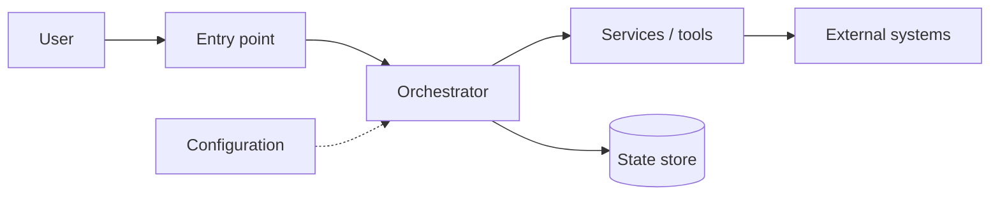
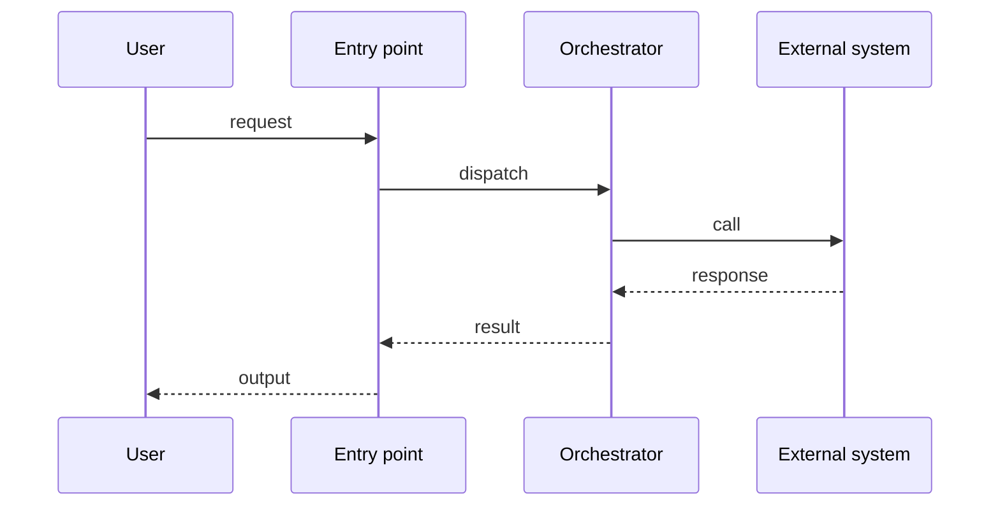

# Architecture — <Project Name>

> **Purpose:** explain how the system is structured and why.
> **Owner:** <name> · **Last reviewed:** <date>

## 1. Overview

<Two or three sentences. What are the main parts and how do they relate?>

## 2. Component Diagram



## 3. Project Layout

```
<repo>/
├── src/
│   ├── <core module>        # responsibility
│   └── <core module>        # responsibility
└── tests/
```

## 4. Request Lifecycle

<Describe one unit of work end to end: what starts it, what state it touches, what ends it.>

## 5. Sequence Diagram



<Add one sequence diagram per non-obvious flow.>

## 6. State & Persistence

| State | Lives where | Lifetime | Reset when |
|-------|-------------|----------|------------|
| <state> | <memory/db/file> | <duration> | <trigger> |

## 7. Interfaces & Contracts

- **Input:** <shape and validation rules>
- **Output:** <shape and guarantees>
- **External APIs:** <protocol, auth, limits>

## 8. Concurrency Model

<Async or sync? What can run in parallel? What is serialized, and why?>

## 9. Configuration & Secrets

- All configuration comes from <env/file/flags>; nothing is hard-coded.
- Secrets are never committed. Document every variable:

| Variable | Purpose | Required |
|----------|---------|----------|
| `<VAR>` | <purpose> | yes/no |

## 10. Error Handling

<What happens on failure at each boundary? What is retried, what is surfaced, what is logged?>

## 11. Architectural Decisions (ADRs)

| # | Decision | Alternative rejected | Why |
|---|----------|----------------------|-----|
| 1 | <choice> | <alternative> | <reason> |

Link detailed records under `docs/adr/`.

## Exit checklist

- [ ] Component and sequence diagrams are Mermaid source
- [ ] Every component has a single clear responsibility
- [ ] State has an owner and a reset rule
- [ ] Configuration is env-based; secrets are not committed
- [ ] Each decision lists the rejected alternative
