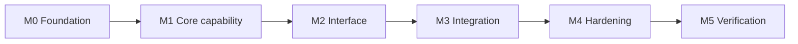

# Implementation Plan — <Project Name>

> **Purpose:** order the work and define when each milestone is done.
> **Owner:** <name> · **Last reviewed:** <date>

## Milestone Map

## Milestone Summary

| # | Milestone | Depends on | Exit criteria (summary) |
|---|-----------|------------|-------------------------|
| M0 | <name> | — | <one line> |
| M1 | <name> | M0 | <one line> |

## M0 — <Name>

**Goal:** <what this milestone delivers.>

**Tasks**
- [ ] <task>
- [ ] <task>

**Exit criteria**
- [ ] <verifiable condition>
- [ ] Verification command passes

## M1 — <Name>

**Goal:** <what this milestone delivers.>

**Tasks**
- [ ] <task>

**Exit criteria**
- [ ] <verifiable condition>

<!-- Repeat one section per milestone. Keep each milestone shippable on its own. -->

## Cross-Cutting Checklist

- [ ] Config and secrets handled from the start
- [ ] Tests written alongside each milestone
- [ ] Docs updated when behavior changes
- [ ] Every milestone leaves the project runnable

## Risks & Mitigations

| Risk | Likelihood | Impact | Mitigation |
|------|-----------|--------|------------|
| <risk> | low/med/high | low/med/high | <action> |

## Exit checklist

- [ ] Milestone dependencies are drawn as a diagram
- [ ] Every milestone has explicit exit criteria
- [ ] Each milestone is independently shippable
- [ ] Risks have owners and mitigations
