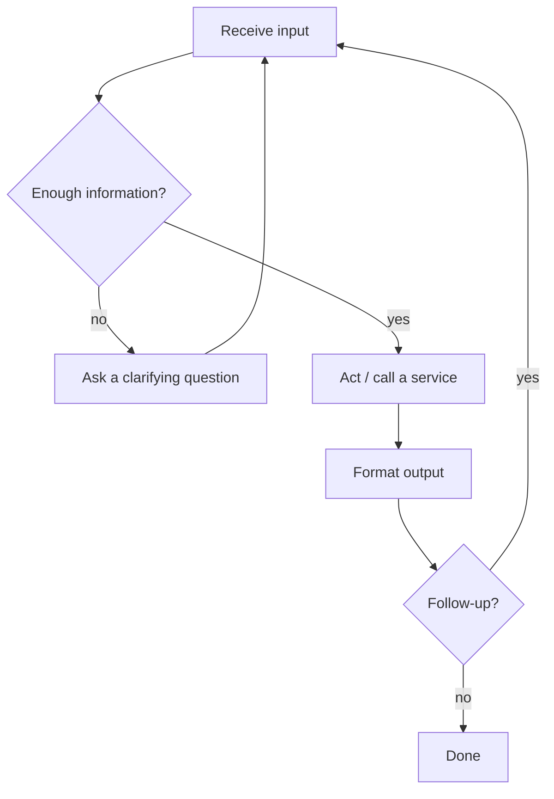

# Workflow — <Project Name>

> **Purpose:** define how the system behaves at runtime, step by step.
> **Owner:** <name> · **Last reviewed:** <date>

## 1. High-Level Loop

## 2. Input Contract

- **Required:** <fields that must be present before acting>
- **Optional:** <fields with defaults>
- **Defaulting rules:** <what is assumed, and when the system must ask instead>

## 3. Decision Rules

| Situation | Behavior |
|-----------|----------|
| Required input missing | Ask the user; do not guess |
| Input ambiguous | Present concrete options |
| Input complete | Act immediately |
| Action fails | <retry / explain / degrade> |

State clearly what the system must **never** do.

## 4. Happy Path

1. <Step>
2. <Step>
3. <Step>

## 5. Edge Cases & Follow-ups

- **Refinement:** <how a user changes a previous request>
- **Partial input:** <how partial answers are combined>
- **Repeated request:** <dedupe or reset behavior>

## 6. Error & Recovery

| Failure | User sees | System does |
|---------|-----------|-------------|
| <failure> | <message> | <action> |

Never surface raw errors or stack traces to the user.

## 7. Output Format

<Exact shape of the response: fields, ordering, formatting rules, what is always included.>

## 8. Invariants

- <Something that must always hold true.>
- <Something that must always hold true.>

## Exit checklist

- [ ] The loop is drawn as a diagram
- [ ] Required vs optional inputs are explicit
- [ ] Every failure has a user-facing message
- [ ] Output format is specified precisely enough to test
- [ ] Invariants are listed and mapped to tests
