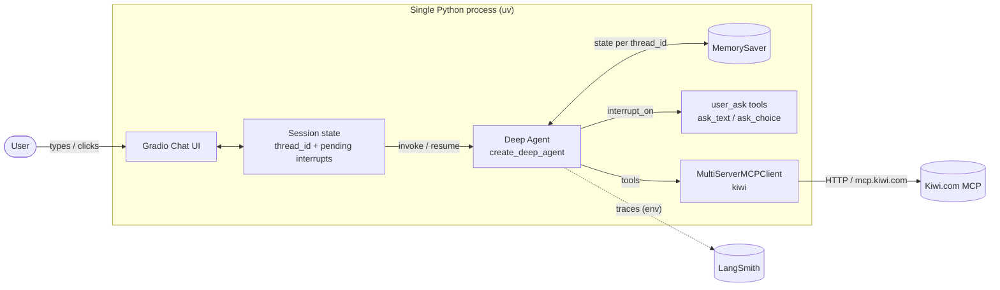
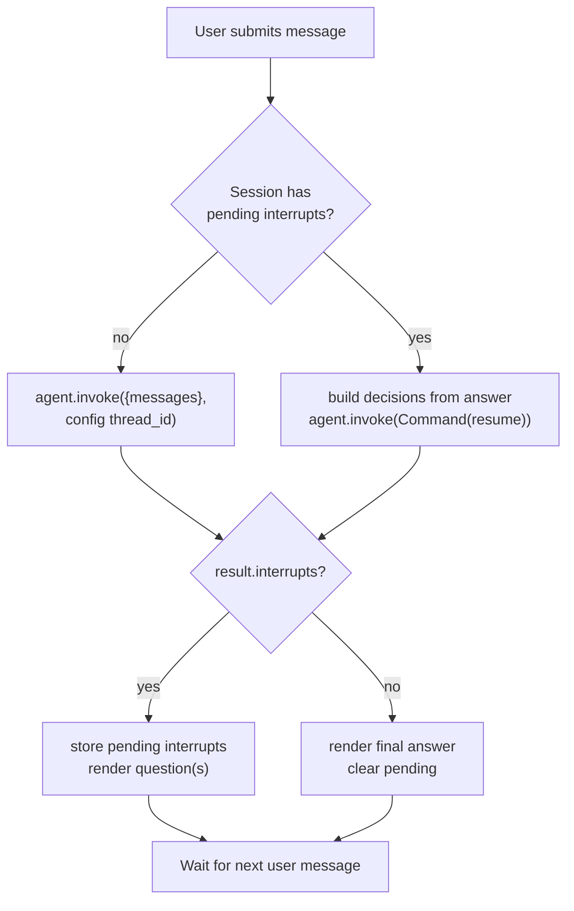
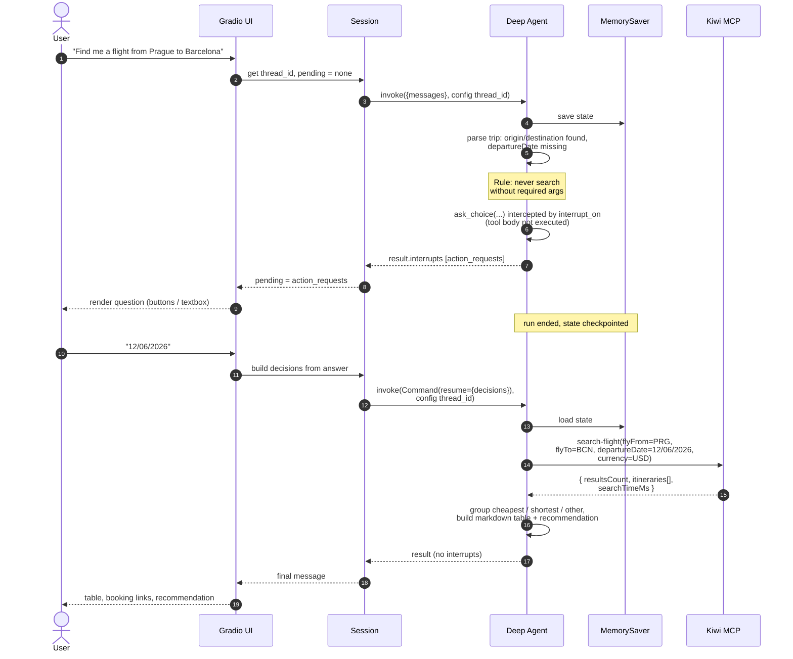
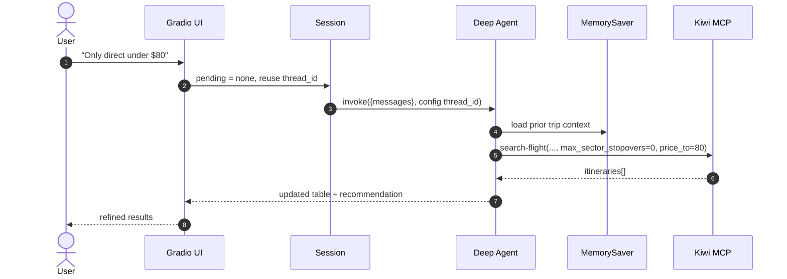
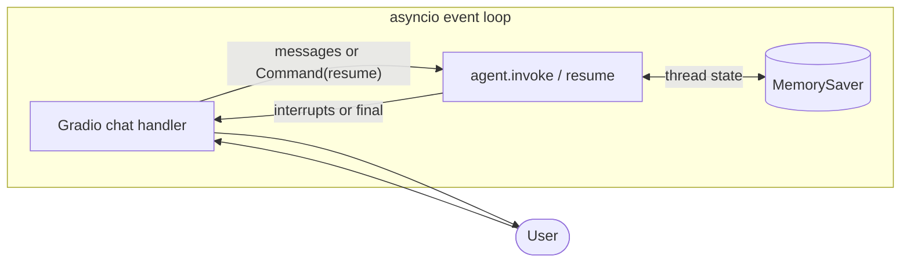

# Architecture — FlightFinder Agent

**Companion docs:** [`PRD.md`](./PRD.md) · [`WORKFLOW.md`](./WORKFLOW.md) · [`TECH_STACK.md`](./TECH_STACK.md) · [`IMPLEMENTATION_PLAN.md`](./IMPLEMENTATION_PLAN.md) · [`STATUS.md`](./STATUS.md)

---

## 1. Overview

FlightFinder Agent is a **single-process, local-only** application with five cooperating parts:

1. **Gradio chat UI** — the only user-facing surface, inherently turn-based.
2. **Deep Agent** — a LangChain `create_deep_agent` tool-calling loop backed by an OpenRouter
   model, configured with `interrupt_on=` for human-in-the-loop (HITL).
3. **Kiwi MCP** — remote HTTP MCP server providing `search-flight`.
4. **`user_ask` tools** — two plain `@tool` declarations (`ask_text`, `ask_choice`). They are
   **intercepted by `interrupt_on`**, never executed for real; their bodies only raise if the
   interrupt config is missing.
5. **Checkpointer (LangGraph `MemorySaver`)** — holds graph state per `thread_id` so a run can be
   paused at an interrupt and resumed with the user's answer.

State is **ephemeral**: the checkpointer is **in-memory only** (no disk), and the Gradio session
drops its `thread_id` on refresh, after which the checkpoint is pruned. No database, no auth.

> **Design change (v0.2):** the earlier in-process `QuestionBroker` (asyncio future/queue
> bridge) was replaced by LangGraph **interrupt/resume**. See ADR-2/ADR-3.

---

## 2. Component Diagram



---

## 3. Project Layout

```
flightFinderAgent/
├── .env.example              # committed template (OpenRouter, LangSmith)
├── .gitignore                # ignores .env, __pycache__, .venv, etc.
├── pyproject.toml            # uv-managed project + deps
├── uv.lock
├── .mcp.json                 # editor MCP config (docs-langchain)
├── README.md
├── AGENTS.md                 # instructions for coding agents
├── docs/
│   ├── PRD.md
│   ├── ARCHITECTURE.md
│   ├── WORKFLOW.md
│   ├── TECH_STACK.md
│   ├── IMPLEMENTATION_PLAN.md
│   ├── STATUS.md
│   └── VERIFICATION.md                # optional: Playwright MCP scenarios & results
├── src/flight_finder/
│   ├── __init__.py
│   ├── config.py             # load .env → typed settings
│   ├── models.py             # OpenRouter ChatOpenAI factory
│   ├── agent.py              # create_deep_agent + interrupt_on + checkpointer
│   ├── budget.py             # per-turn search counter (anti-loop)
│   ├── logging_utils.py      # structured tool-call logging
│   ├── session.py            # Session: thread_id, pending interrupts, pruning
│   ├── mcp/
│   │   ├── __init__.py
│   │   └── kiwi.py           # MCP client + retry/timeout + one-way adapter
│   ├── tools/
│   │   ├── __init__.py
│   │   └── user_ask.py       # @tool declarations (intercepted, never executed)
│   ├── ui/
│   │   └── app.py            # Gradio ChatInterface + invoke/resume handling
│   └── main.py               # entrypoint: python -m flight_finder.main
├── scripts/
│   ├── compare_models.py     # manual OpenRouter model A/B
│   └── e2e_browser.py        # Playwright MCP browser E2E (M7)
└── tests/
    ├── support.py            # scripted model + fake search tool
    ├── conftest.py           # shared fixtures
    ├── test_agent_flow.py    # clarify → search → refine
    ├── test_clarification.py # clarify-before-search invariants
    ├── test_hardening.py     # search cap, retry, logging
    ├── test_interrupts.py    # interrupt/resume/prune
    └── test_kiwi_live.py     # opt-in live MCP test
```

---

## 4. Request Lifecycle (turn-based)

Gradio is already turn-based, which maps directly onto interrupt/resume. Each user submission is
one `agent.invoke(...)`; if the run stops at an interrupt, the next submission is a
`Command(resume=...)`.

- **`thread_id`** — one per browser session, stored in `gr.State`.
- **`pending`** — the `action_requests` from the last interrupt, also in `gr.State`.
- **Checkpointer** — saves/restores graph state between the two halves of a paused turn.



---

## 5. Sequence Diagram (primary flow)

Scenario: the user omits the date, so the agent interrupts **before** searching, then resumes.



### 5.1 Refinement flow (no new question)



---

## 6. Human-in-the-Loop via Interrupts

### 6.1 Why interrupts (and not a broker)

Gradio processes one chat submission per event. LangGraph's interrupt/resume is the same shape:
a run runs until it needs the human, **ends**, and is **resumed** from a checkpoint later. This
removes the need for a background agent task, in/out queues, or an asyncio `Future` bridge.

Trade-off vs. the old `QuestionBroker`: the run no longer streams continuously across a
question (each resume restarts execution from the checkpoint), and a checkpointer is now
required. In exchange we delete the most fragile concurrency code and gain
approve/edit/reject support for future tools.

### 6.2 Tools

| Tool | Schema | Decision type |
|------|--------|---------------|
| `ask_text` | `{ question: str, context?: str }` | `respond` |
| `ask_choice` | `{ question: str, options: list[str] (2–10), allow_multiple?: bool }` | `respond` |

Bodies are **not** executed under `interrupt_on`. Implement them as a defensive `raise` so a
missing interrupt entry fails loudly instead of returning fake data.

### 6.3 Wiring

```python
# agent.py
from deepagents import create_deep_agent

INTERRUPT_ON = {
    "ask_text":   {"allowed_decisions": ["respond"]},
    "ask_choice": {"allowed_decisions": ["respond"]},
}

async def build_agent(*, model=None, kiwi_tools=None, checkpointer=None):
    if kiwi_tools is None:
        toolset = select_kiwi_tools(await get_kiwi_tools())
        tools = list(toolset.agent_tools())   # search-flight only
    else:
        tools = list(kiwi_tools)              # tests inject a fake
    tools.extend(get_user_ask_tools())

    return create_deep_agent(
        model=model or get_model(),
        tools=tools,
        system_prompt=SYSTEM_PROMPT,
        interrupt_on=build_interrupt_on(),
        checkpointer=checkpointer or build_checkpointer(),
    )
```

`feedback-to-devs` is intentionally **not** wired into the agent, so it can never be
invoked automatically. `build_agent` is async because Kiwi tools are fetched over MCP;
`kiwi_tools` and `checkpointer` are injectable for tests.

### 6.4 Turn handling in Gradio

```python
# ui/app.py (sketch)
from flight_finder.session import pending_questions, resume_with, run_turn

if session.pending is None:
    result = await run_turn(agent, session, text)     # sets session.pending
else:
    result = await resume_with(agent, session, session.pending, text)

if session.pending:
    questions = pending_questions(session.pending)  # render next
else:
    ...                                             # render final reply
```

`build_decisions` maps each pending `action_request` to a decision:

```python
{"type": "respond", "message": answer}
```

> LangGraph's `invoke` returns a state dict whose interrupts live under
> `result["__interrupt__"]`; `session.interrupts_of()` also accepts a
> `result.interrupts` attribute, so the UI is version-agnostic.

For a multi-request pause, collect one decision per request and resume **once**. `ask_choice`
with `allow_multiple` is deferred in v1; use `ask_text` for multi-value answers until the UI
supports multi-select. `resume_with` refuses to run when the session has no pending interrupt
(for example after pruning), so a stale result cannot silently start a new conversation.

### 6.5 Thread lifecycle (must handle)

`MemorySaver` keeps state in process memory even after the browser state is gone. To preserve
"refresh clears the chat", the session owns its thread and prunes it:

- Create a fresh `thread_id` per browser session (in `gr.State`).
- On session teardown / reload, call `checkpointer.delete_thread(thread_id)` if the pinned
  LangGraph version exposes it; otherwise keep a registry of live `thread_id`s and clear stale
  entries.
- Never reuse a `thread_id` across users.

If pruning is skipped, the in-memory checkpoint grows and a reloaded session could accidentally
resume an old conversation — which violates the PRD's ephemerality requirement.

---

### 6.6 Hardening and guardrails

- **Search budget** — `SearchBudgetMiddleware` counts `search-flight` calls per
  `thread_id`; the 4th call in a turn returns an error `ToolMessage` telling the model to
  summarise what it has. `session.run_turn()` resets the counter at the start of each turn.
- **Kiwi MCP resilience** — 30 s HTTP timeout, 120 s SSE read timeout, one retry with
  backoff, then a clear `RuntimeError` instead of hanging the Gradio event.
- **Structured logging** — `ToolCallLogger` logs tool name, input preview, output size, and
  error type (never full payloads or tracebacks). Turn start/end and pending state are logged
  by `session.py`.
- **Empty results** — the system prompt requires a plain "no results" message plus suggestions
  (widen dates, nearby airports, remove a filter).
- **No raw errors** — the UI catches exceptions and renders a friendly message.

## 7. Kiwi MCP Integration

```python
# mcp/kiwi.py
from langchain_mcp_adapters.client import MultiServerMCPClient

async def get_kiwi_tools():
    client = MultiServerMCPClient({
        "kiwi": {"transport": "http", "url": "https://mcp.kiwi.com"}
    })
    return await client.get_tools()   # -> [search-flight, feedback-to-devs]
```

- **No API key.** The endpoint is HTTP and unauthenticated.
- `search-flight` is the only tool the agent should call during normal operation.
- `feedback-to-devs` is loaded but only invoked on explicit user request (or excluded from the
  tool list and offered separately — see IMPLEMENTATION_PLAN).
- Only a subset of args are used in v1 (one-way): `flyFrom`, `flyTo`, `departureDate`,
  `departureDateFlexDays`, `departureDateTo`, `adults`/`children`/`infants`, `cabinClass`,
  `currency`, `locale`, `max_sector_stopovers`, `price_from`/`price_to`, `max_fly_duration`,
  `select_airlines`/`exclude_airlines`, time windows, `one_for_city`, `fly_days`, `sort`.

---

## 8. Concurrency Model

There is **no background agent task and no queue bridge**. Each Gradio submission runs one
agent step synchronously within the event handler (or as an awaited coroutine); interrupts end
that step and persist state.



- Only **one agent step per session** runs at a time (Gradio serializes a session's events).
- Different sessions are isolated by `thread_id`.
- No cross-session shared mutable state except the checkpointer store.

---

## 9. Configuration & Secrets

`config.py` loads `.env` (via `python-dotenv`) and exposes typed settings.

| Variable | Purpose | Default |
|----------|---------|---------|
| `OPENROUTER_API_KEY` | OpenRouter auth | — (required) |
| `OPENROUTER_BASE_URL` | API base | `https://openrouter.ai/api/v1` |
| `OPENROUTER_MODEL` | Model id | `nvidia/nemotron-3-ultra-550b-a55b:free` |
| `LANGCHAIN_TRACING_V2` | Enable LangSmith | `false` |
| `LANGCHAIN_API_KEY` | LangSmith auth | — (optional) |
| `LANGCHAIN_PROJECT` | Trace project | `flightfinder-agent` |
| `LANGCHAIN_ENDPOINT` | LangSmith endpoint | `https://api.smith.langchain.com` |
| `KIWI_MCP_URL` | Kiwi endpoint override | `https://mcp.kiwi.com` |
| `DEFAULT_CURRENCY` | Search currency | `USD` |
| `DEFAULT_LOCALE` | Search locale | `en` |

**LangSmith tracing** is enabled purely by env vars — deep agents run on LangGraph, so the
LangChain tracer auto-instruments agent steps, tool calls, interrupts, and MCP calls with **no
code changes**. Put `LANGCHAIN_*` in `.env` and traces appear in the configured project.

---

## 10. Testing Strategy

Tests target the **agent layer only** — no Gradio, no browser.

- **Interrupt harness instead of a scripted broker.** Tests call `agent.invoke(...)`, inspect
  `result.interrupts`, and feed answers via `Command(resume={"decisions": ...})` — exactly what
  the UI does. A `resume_with(result, answers)` helper plays the human's role.
- **Kiwi is mocked by default** (fixture with representative `itineraries`); an opt-in
  integration test hits the real MCP (`RUN_KIWI_LIVE=1`).
- **Deterministic where possible**: use a fake/scripted model for pure flow tests so the suite
  doesn't depend on network or on an OpenRouter model's tool-calling quality; use a real model
  in the opt-in A/B run.
- **Invariants under test:**
  - never call `search-flight` without `flyFrom`/`flyTo`/`departureDate`;
  - the clarification turn produces an `ask_*` interrupt before any search;
  - resuming with an answer continues to `search-flight`;
  - currency defaults to USD; one-way args never include `returnDate`;
  - final output contains a table with route, times, price, and `bookingUrl` for each row;
  - refinement reuses prior thread context and applies new filters.
- Because models are swapped by env var, the same suite can run **model A/B comparisons** for
  cost vs. quality.
- **Browser E2E (final, M7):** once M0–M6 are done, the **Playwright MCP** server drives the
  real Gradio UI (live model + live Kiwi MCP). It covers happy path, clarification/resume,
  refinement, empty results, and refresh-reset. Playwright MCP is a **verification tool only**
  and is not part of the app's runtime.

---

## 11. Error Handling

| Failure | Behavior |
|---------|----------|
| Kiwi MCP unreachable / 5xx | Friendly message, offer retry; log the error; no traceback to user |
| Empty `itineraries` | Suggest flex dates, nearby airports, or relaxed filters |
| Interrupt never resumed / thread pruned | Drop `pending`; start a fresh turn; report what was missing |
| Checkpointer missing / `interrupt_on` misconfigured | Tool body raises; caught and surfaced as a clear config error |
| Model returns no/invalid tool call | Bounded retry, then friendly failure (no infinite loop) |
| Invalid/past date | Re-clarify the date before searching |

---

## 12. Architectural Decisions (ADRs)

| # | Decision | Rationale |
|---|----------|-----------|
| ADR-1 | Single process, local only | Simplest; matches requirements |
| ADR-2 | HITL via LangGraph `interrupt_on` + `Command(resume)` | Gradio is turn-based; removes custom concurrency code |
| ADR-3 | `user_ask` are `@tool` declarations intercepted, not executed | Same-process callback needs no wire protocol; MCP is only for remote Kiwi |
| ADR-4 | In-memory `MemorySaver`, thread pruned on refresh | Ephemeral chat without a disk DB; pruning prevents leaky resumes |
| ADR-5 | Model/tracing via env only | Model A/B testing, zero-code swaps |
| ADR-6 | No subagents | Explicit v1 scope; single deep-agent loop |
| ADR-7 | Browser E2E via Playwright MCP, only after M6 | Final confidence pass over the real UI; not an app dependency |
