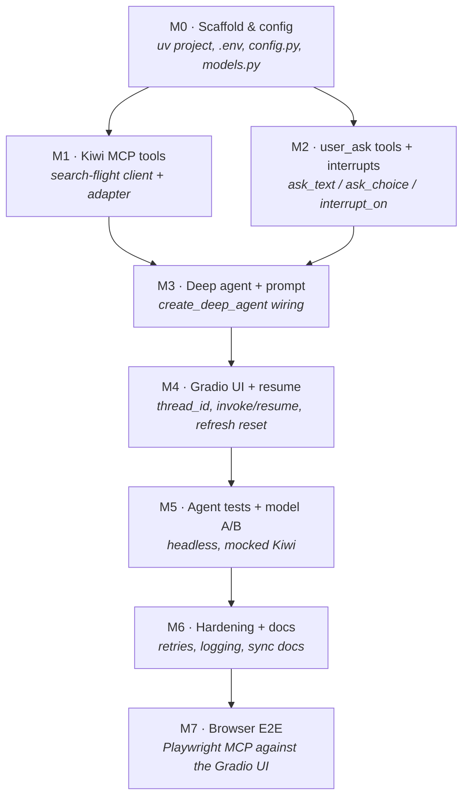

# Implementation Plan — FlightFinder Agent

**Companion docs:** [`PRD.md`](./PRD.md) · [`ARCHITECTURE.md`](./ARCHITECTURE.md) · [`WORKFLOW.md`](./WORKFLOW.md)

Milestone-based plan. Each milestone is independently verifiable and leaves the repo runnable.

> **Live progress:** [`STATUS.md`](./STATUS.md) tracks which milestone is done/in progress
> across agents. Update it when you start or stop work.

---

## Milestone Map

Seven milestones, each independently verifiable. Arrows are hard dependencies. M7 is a final
browser E2E stage run **after everything else is done**.

### Milestone summary

| ID | Milestone | Depends on | Est. effort | Exit criteria |
|----|-----------|-----------|-------------|---------------|
| M0 | Scaffold & config | — | 0.5 day | `uv sync` works; settings load from `.env` |
| M1 | Kiwi MCP tools | M0 | 0.5 day | Live `search-flight` call returns itineraries |
| M2 | `user_ask` tools + interrupts | M0 | 1 day | `ask_*` call yields `result.interrupts`; resume continues |
| M3 | Deep agent + prompt | M1, M2 | 1.5 days | Scripted dialogue asks → searches → refines |
| M4 | Gradio UI + interrupt resume | M3 | 1.5 days | End-to-end flow works in a browser |
| M5 | Agent tests + model A/B | M4 | 1 day | `uv run pytest` green offline |
| M6 | Hardening + docs | M5 | 0.5 day | No loops, no tracebacks, docs in sync |
| M7 | Browser E2E (Playwright MCP) | M6 | 0.5 day | Full chat flow passes in a real browser |

---

## M0 — Scaffold & Configuration

**Deliverables**
- `uv` project (`pyproject.toml`, `uv.lock`), `src/flight_finder/` package.
- `.env.example` + `.gitignore` (ignore `.env`, `.venv`, `__pycache__`).
- `config.py`: load `.env`, typed settings for OpenRouter, LangSmith, Kiwi, defaults.
- `models.py`: OpenRouter `ChatOpenAI` factory reading `config`.
- Skeleton modules for `agent.py`, `session.py`, `mcp/*`, `tools/*`, `ui/app.py`, `main.py`.

**Acceptance**
- `uv sync` works.
- `uv run python -c "from flight_finder.config import settings; print(settings)"` prints config.
- Tracing toggles on via env only.

---

## M1 — Kiwi MCP Tools

**Deliverables**
- `mcp/kiwi.py`: `MultiServerMCPClient({"kiwi": {"transport":"http","url":...}})` →
  `get_tools()`.
- Filter/normalize tools: keep `search-flight`; hold `feedback-to-devs` for explicit use.
- Thin adapter mapping the internal trip context → `search-flight` args (one-way only).

**Acceptance**
- Live smoke test lists both Kiwi tools and performs one real search.
- Adapter never emits return-related args.
- Missing `KIWI_MCP_URL` falls back to `https://mcp.kiwi.com`.

---

## M2 — `user_ask` Tools + HITL Interrupts

**Deliverables**
- `tools/user_ask.py`: `@tool` `ask_text` and `ask_choice`; bodies raise defensively (never
  executed under `interrupt_on`).
- `agent.py` (or shared config): `interrupt_on` entries with `allowed_decisions=["respond"]`.
- `session.py`: `Session` with `thread_id` + `pending` interrupts; thread pruning helper.
- `checkpointer` wiring (`MemorySaver`).

**Acceptance**
- Unit test: calling `ask_text`/`ask_choice` yields `result.interrupts` (no execution).
- A `resume_with(result, answers)` helper drives `Command(resume=...)` and continues the run.
- Dropping/pruning the thread prevents a later resume.

---

## M3 — Deep Agent + System Prompt

**Deliverables**
- `agent.py`: `create_deep_agent(model=..., tools=[kiwi + user_ask], system_prompt=...,
  interrupt_on={...}, checkpointer=MemorySaver())`.
- System prompt encoding WORKFLOW §8 (clarify-before-search, one-way, formatting,
  safety, errors).
- Session-scoped trip context via thread checkpoints for follow-ups/refinement.

**Acceptance**
- Scripted dialogue: incomplete request → asks; complete request → searches; follow-up →
  refines.
- Invariant test: no `search-flight` without required args.
- Output includes grouped table + recommendation + `bookingUrl`.

---

## M4 — Gradio UI + Interrupt Resume

**Deliverables**
- `ui/app.py`: `gr.ChatInterface` (or `Blocks`) with markdown rendering.
- Per-session `gr.State`: `thread_id` + `pending` interrupts (no queues/broker/task).
- Handler routes a message to `agent.invoke(...)` (new turn) or
  `agent.invoke(Command(resume=...))` (answer), then renders interrupts or the final reply.
- Chat clears on reload; prune the thread's checkpoint on session teardown.
- Marker block for future hero images.

**Acceptance**
- End-to-end in browser: ask → question appears → answer → results table → refine.
- Refresh clears the chat.
- Errors render as friendly messages.

---

## M5 — Agent Tests + Model A/B

**Deliverables**
- `tests/`: `conftest.py` (interrupt harness + Kiwi fixtures), `test_agent_flow.py`,
  `test_clarification.py`.
- `resume_with(result, answers)` helper that plays the UI role (`Command(resume=...)`).
- Kiwi mocked by default; `RUN_KIWI_LIVE=1` enables live integration.
- A script to run the same suite across `OPENROUTER_MODEL` values and capture
  cost/quality notes.

**Acceptance**
- `uv run pytest` green offline.
- `RUN_KIWI_LIVE=1 uv run pytest` green against real MCP.
- Model can be swapped by env only; comparison notes recorded.

---

## M6 — Hardening + Docs

**Deliverables**
- Bounded retries, timeout/cancel paths, search-count cap, empty-result suggestions.
- Structured logging of turns, tool calls, search args, and result counts.
- Finalize `README.md`, keep PRD/ARCHITECTURE/WORKFLOW in sync.
- Optional: lint/format config (`ruff`).

**Acceptance**
- No infinite loops; no tracebacks reach the user.
- Docs match behavior.
- `README` quickstart works from a clean clone.

---

## M7 — Browser E2E with Playwright MCP

Run **only after M0–M6 are complete**. This is the final acceptance pass against the real app
(no mocks), driving the Gradio UI through the official **Playwright MCP** server.

**Deliverables**
- Add the Playwright MCP server to the agent/editor MCP config (e.g. `.mcp.json`):
  `npx @playwright/mcp@latest` over stdio (or the configured HTTP variant).
- A documented E2E scenario set (below) and a short `docs/VERIFICATION.md` (or a section in this doc)
  recording how to run it, prerequisites, and expected outcomes.
- Screenshots/traces captured on failure (Playwright MCP screenshot + trace options).

**Scenarios**
1. **Happy path** — search with complete inputs → results table with routes, times, price,
   and a working `bookingUrl` link.
2. **Clarification** — omit the date → agent asks → answer → search runs → results render.
3. **Refinement** — follow up with "only direct under $80" → filtered results update.
4. **Empty results** — impossible route/date → friendly message + suggestions.
5. **Refresh resets** — reload the page → prior chat is gone and no stale resume occurs.

**Acceptance**
- All scenarios pass against `uv run python -m flight_finder.main` with a real model and live
  Kiwi MCP.
- No uncaught console errors; no stack traces shown to the user.
- Refresh scenario confirms the `thread_id` was pruned (no resumed conversation).
- Results are documented in `docs/STATUS.md` (M7) with pass/fail per scenario.

> Playwright MCP is a **test tool**, not a runtime dependency of the app. It is invoked by the
> coding agent during verification; it does not ship in the app process.

---

## Cross-Cutting Checklist

- [ ] `uv` used exclusively for deps and runs.
- [ ] No secrets in git; `.env.example` documents every variable.
- [ ] LangSmith tracing works with env only.
- [ ] One-way invariants enforced and tested.
- [ ] Agent tests run headless (no UI, no live network by default).
- [ ] Model swap requires zero code changes.
- [ ] Browser E2E passes via Playwright MCP (M7).

---

## Suggested Dependency Set

| Package | Purpose |
|---------|---------|
| `deepagents` | `create_deep_agent` |
| `langchain-openai` | `ChatOpenAI` for OpenRouter |
| `langchain-mcp-adapters` | `MultiServerMCPClient`, `load_mcp_tools` |
| `langchain-core` | `@tool` for `user_ask` (comes with LangChain) |
| `langgraph` | `MemorySaver`, `Command(resume)`, interrupt plumbing |
| `gradio` | Chat UI |
| `python-dotenv` | `.env` loading |
| `langsmith` | Tracing (auto via env) |
| `pytest`, `pytest-asyncio` | Agent tests (dev) |

---

## Risks & Mitigations

| Risk | Mitigation |
|------|------------|
| Checkpoints leak after reload | Prune the session's `thread_id` on teardown (ARCHITECTURE §6.5) |
| Resume into wrong/stale thread | Fresh `thread_id` per session; never reuse across users |
| Weak OpenRouter model tool-calling | Bounded retries; model is swappable for A/B |
| Kiwi API changes/rate limits | Normalize behind an adapter; cap searches per turn |
| Flaky network to `mcp.kiwi.com` | Retry + clear user messaging; mock in tests |
