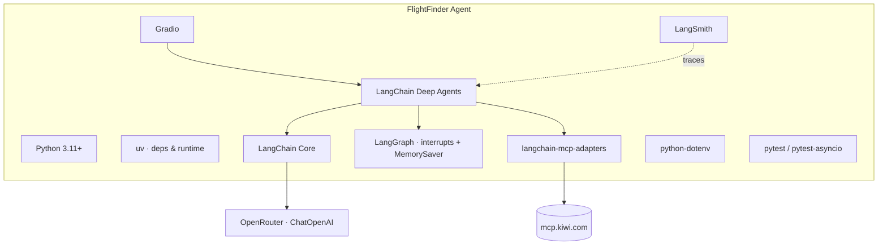

# Tech Stack — FlightFinder Agent

**Companion docs:** [`PRD.md`](./PRD.md) · [`ARCHITECTURE.md`](./ARCHITECTURE.md) · [`WORKFLOW.md`](./WORKFLOW.md) · [`IMPLEMENTATION_PLAN.md`](./IMPLEMENTATION_PLAN.md)

Every technology used, what it does here, and why it was chosen.

---

## 1. At a Glance

---

## 2. Core Stack

| Layer | Technology | Role | Why |
|-------|-----------|------|-----|
| Language | **Python 3.11+** | Application language | Async support, best LangChain/Gradio ecosystem |
| Package mgr | **uv** | Install deps, manage venv, run commands | Single fast tool; requirement; no pip/poetry |
| Agent framework | **LangChain Deep Agents** (`deepagents`) | `create_deep_agent` tool-calling loop | Built-in deep-agent harness; no subagents needed |
| Agent core | **LangChain Core** (`langchain-core`) | `@tool`, messages, runnables | Provides the `@tool` decorator for `user_ask` |
| HITL / state | **LangGraph** (`langgraph`) | `interrupt_on`, `Command(resume)`, `MemorySaver` | Turn-based human-in-the-loop + in-memory checkpoints |
| LLM client | **langchain-openai** (`ChatOpenAI`) | OpenAI-compatible client | OpenRouter speaks the OpenAI API |
| LLM gateway | **OpenRouter** | Hosts/swaps models behind one API | Cheap model A/B for cost vs. quality |
| Default model | **`nvidia/nemotron-3-ultra-550b-a55b:free`** | Default reasoning model | Free; tool-calling capable; swappable via env |
| Remote tooling | **Kiwi.com MCP** (`https://mcp.kiwi.com`) | `search-flight`, `feedback-to-devs` | Official flight-search MCP; no auth |
| MCP adapter | **langchain-mcp-adapters** | `MultiServerMCPClient`, `load_mcp_tools` | Converts MCP tools → LangChain tools |
| UI | **Gradio** | Chat interface | Fastest path to a chat UI in Python; inherently turn-based |
| Config | **python-dotenv** | Load `.env` | Keep secrets out of code/git |
| Tracing | **LangSmith** | Agent/tool traces | Env-only, auto-instruments LangGraph |
| Testing | **pytest** + **pytest-asyncio** | Agent-layer tests | Headless, deterministic, model A/B friendly |

---

## 3. Dependency List

| Package | Kind | Purpose |
|---------|------|---------|
| `deepagents` | runtime | `create_deep_agent` (+ `interrupt_on`) |
| `langchain-core` | runtime | `@tool`, message primitives |
| `langgraph` | runtime | `MemorySaver`, `Command(resume)` |
| `langchain-openai` | runtime | `ChatOpenAI` → OpenRouter |
| `langchain-mcp-adapters` | runtime | Kiwi MCP client/tools |
| `gradio` | runtime | Chat UI |
| `python-dotenv` | runtime | `.env` loading |
| `langsmith` | runtime (optional) | Tracing, enabled via env |
| `pytest` | dev | Test runner |
| `pytest-asyncio` | dev | Async agent tests |
| `ruff` | dev (optional) | Lint + format |

> `mcp` is pulled in **transitively** by `langchain-mcp-adapters`. `user_ask` does **not** use
> it — it is plain LangChain `@tool`s intercepted by `interrupt_on` (see ARCHITECTURE §6).
> `langgraph` is also a transitive dependency of `deepagents`, but it is listed explicitly
> because we use `MemorySaver` and `Command(resume)` directly.

---

## 4. External Services

| Service | Transport | Auth | Used for |
|---------|-----------|------|----------|
| **Kiwi.com MCP** (`mcp.kiwi.com`) | HTTP (MCP) | None | Live flight search |
| **OpenRouter** (`openrouter.ai/api/v1`) | HTTPS (OpenAI API) | `OPENROUTER_API_KEY` | Model inference |
| **LangSmith** (`api.smith.langchain.com`) | HTTPS | `LANGCHAIN_API_KEY` (optional) | Tracing/observability |
| **Playwright MCP** (`@playwright/mcp`) | stdio via `npx` | None | Final browser E2E only (M7) |

---

## 5. Runtime & Environment

| Aspect | Choice |
|--------|--------|
| Runtime model | Single process, **local only** |
| Async model | `asyncio`; one `invoke`/`resume` step per chat submission (no background task/queues) |
| State | **Ephemeral** — in-memory `MemorySaver` per `thread_id`, thread pruned on reload |
| Persistence | None on disk (in-memory checkpointer only) |
| Auth | None |
| Deployment | Local dev (`uv run python -m flight_finder.main`) |

---

## 6. Tooling by Concern

| Concern | Tool | Notes |
|---------|------|-------|
| Environment / deps | uv | `uv sync`, `uv add`, `uv run` |
| Secrets | `.env` + `.env.example` | `.env` git-ignored |
| Tracing | LangSmith | Enable with `LANGCHAIN_TRACING_V2=true` |
| Logging | stdlib `logging` | Turns, tool calls, search args/results |
| Tests | pytest / pytest-asyncio | Kiwi mocked; `RUN_KIWI_LIVE=1` for live |
| Browser E2E | Playwright MCP | Final pass only (M7); not an app dependency |
| Docs | Markdown + Mermaid | This repo's `docs/` |

---

## 7. Explicitly Not Used (v1)

| Not used | Reason |
|----------|--------|
| Subagent frameworks | Out of scope; single deep-agent loop |
| Persistent checkpointers (SQLite/Postgres/Redis) | In-memory `MemorySaver` only; no disk/DB |
| Docker / cloud deploy | Local-only requirement |
| Real MCP server for `user_ask` | In-process callback; MCP adds no value |
| pip / poetry / conda | `uv` is the single package manager |
| Booking/payment SDKs | Search-only in v1 |
| Playwright in-app / as a runtime dep | Browser E2E uses the external Playwright MCP server only |
