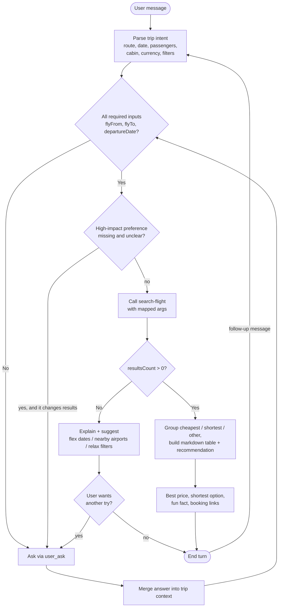
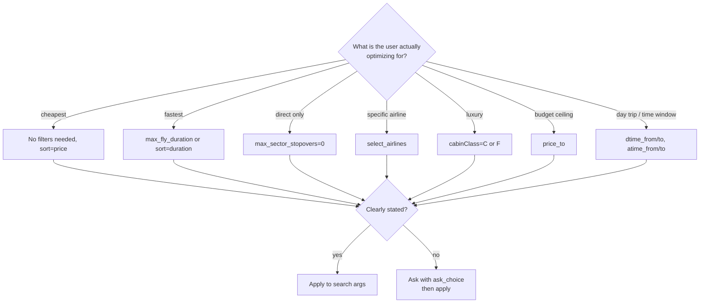
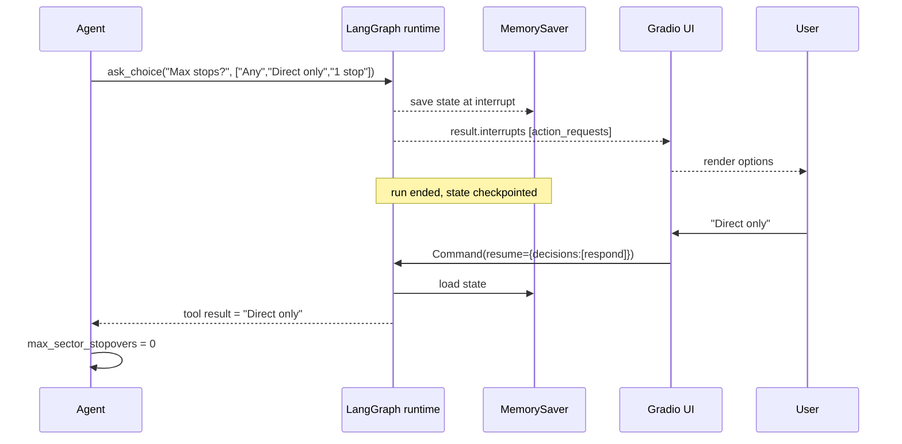
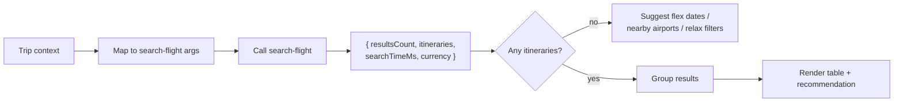
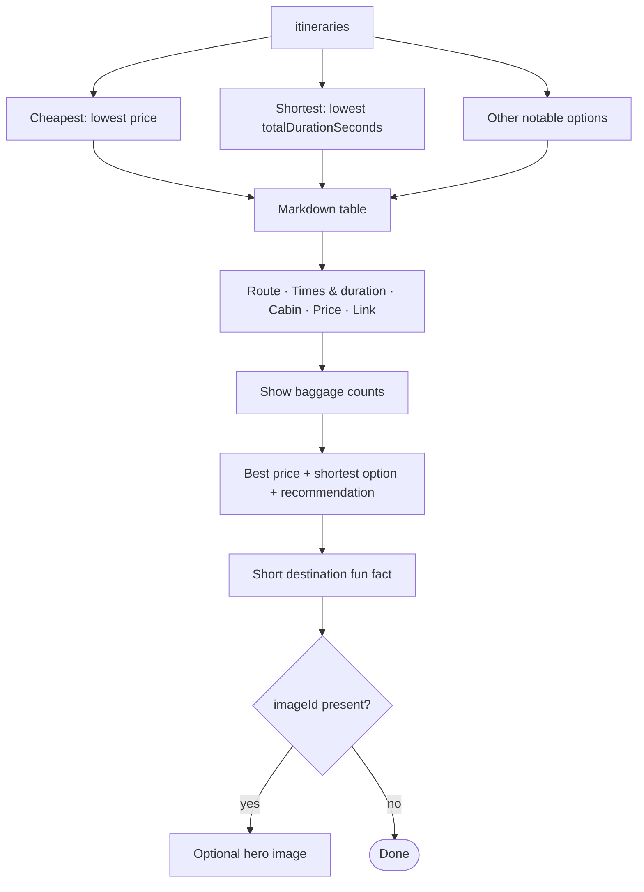
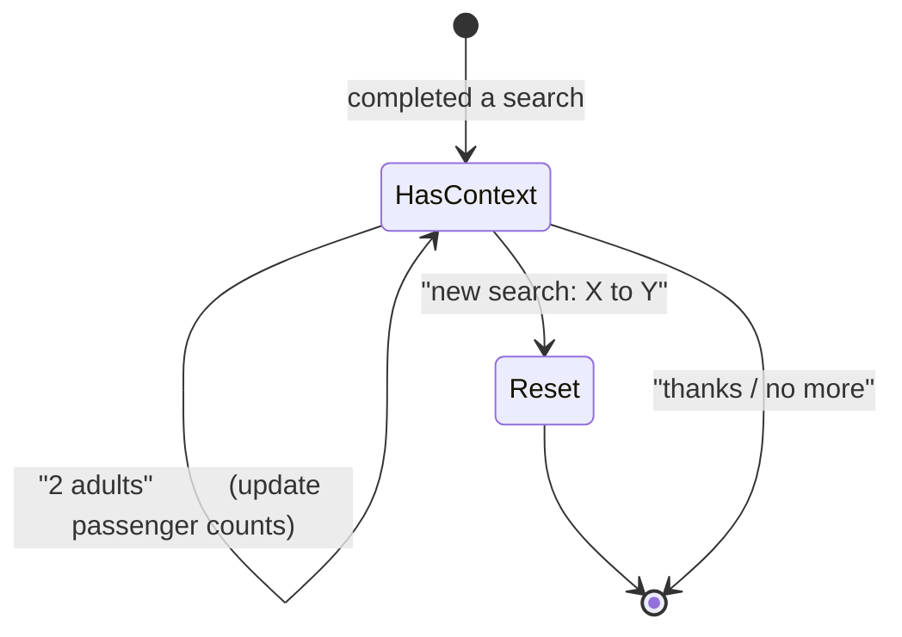
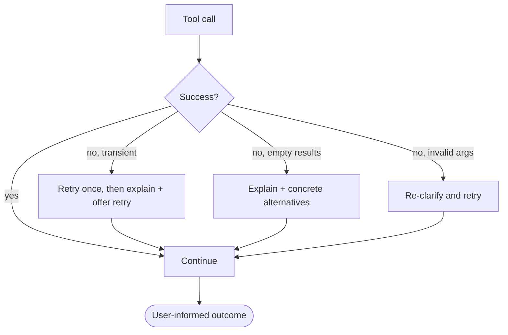
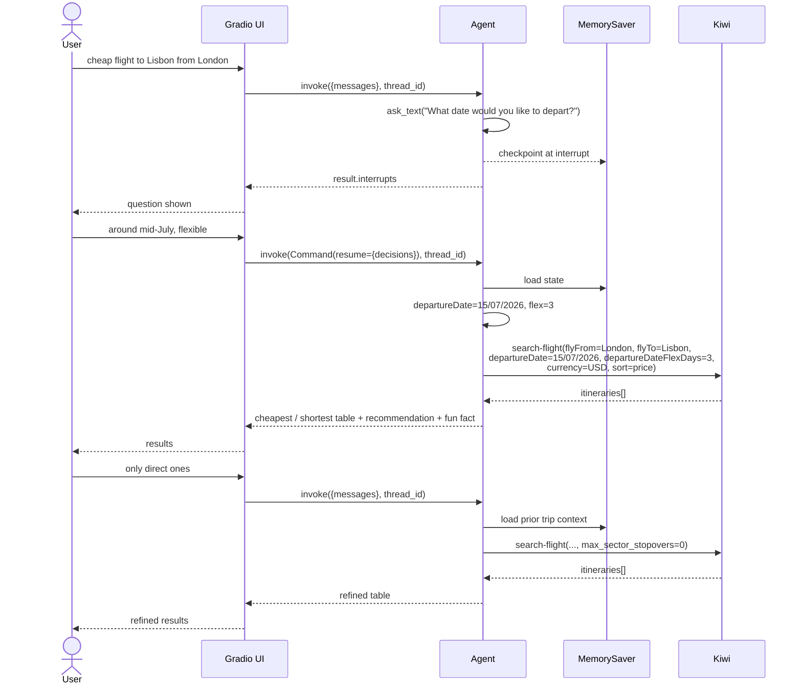

# Agent Workflow — FlightFinder Agent

**Companion docs:** [`PRD.md`](./PRD.md) · [`ARCHITECTURE.md`](./ARCHITECTURE.md) · [`IMPLEMENTATION_PLAN.md`](./IMPLEMENTATION_PLAN.md)

This document describes **how the deep agent behaves**: the decision loop, when it asks
questions, how it calls Kiwi, how it formats results, and how it handles refinement.

---

## 1. High-Level Loop



> **Ask = interrupt.** Every `Clarify` step is an `interrupt_on` pause, not a blocking call.
> The run ends at the interrupt and resumes on the next user message (see
> [`ARCHITECTURE.md`](./ARCHITECTURE.md) §6).

---

## 2. Clarify-Before-Search Rules

Required inputs **must** be present before any search:

| Input | Source | If missing |
|-------|--------|-----------|
| `flyFrom` | text | ask (`ask_text` if open, `ask_choice` if a couple of likely options) |
| `flyTo` | text | ask |
| `departureDate` | text | ask; if the user is flexible, ask for a date **or** a range |

Optional-but-asked-when-decided matters:



**Do not over-question.** Defaults (1 adult, economy, USD, no filters) are assumed unless the
user says otherwise. Ask at most what materially changes the result.

### Clarification event flow (interrupt/resume)



> The `ask_*` tool body never executes. `interrupt_on` intercepts the call; the answer arrives
> as the tool result on resume.

---

## 3. Intent Parsing Contract

The agent extracts this internal trip context and keeps it for the session:

```json
{
  "flyFrom": "Prague",
  "flyTo": "Barcelona",
  "departureDate": "12/06/2026",
  "departureDateFlexDays": 0,
  "departureDateTo": null,
  "adults": 1,
  "children": 0,
  "infants": 0,
  "cabinClass": null,
  "currency": "USD",
  "locale": "en",
  "max_sector_stopovers": null,
  "price_to": null,
  "max_fly_duration": null,
  "select_airlines": null,
  "exclude_airlines": null,
  "sort": "price"
}
```

Normalization rules:
- Dates → `dd/mm/yyyy` (Kiwi's format). "next Friday" etc. are resolved to a concrete date.
- Place names kept as-is; Kiwi resolves IATA/city/airport automatically.
- Cabin words → `M`/`W`/`C`/`F` (economy / premium / business / first).
- Currency defaults to `USD`; locale to `en`.
- One-way: **never** set `returnDate`, `returnDateFlexDays`, `returnDateTo`, `nights_in_dst_*`,
  or `ret_*`.

---

## 4. Search Workflow



### Searching with flexibility
When the exact date yields nothing (or the user says "around then"), the agent may search a
**bounded** range:
- `departureDateFlexDays` (±N, 0–10) for symmetric flexibility, **or**
- `departureDateTo` for an asymmetric range.

The agent must avoid unbounded/brute-force searching (see IMPLEMENTATION_PLAN for a cap).

---

## 5. Result Formatting Workflow

Follow Kiwi's own display guidance.



Example table row semantics:

| Column | Source |
|--------|--------|
| Route | `outbound.route.join(" → ")` (e.g. `PRG → MAD → BCN`) |
| Times & duration | `outbound.departureTime` → `arrivalTime` (local) + `durationSeconds` |
| Cabin | `outbound.cabinClass` |
| Price | `priceFormatted` |
| Link | `[Book](bookingUrl)` |
| Baggage | `baggage.personalItem / cabinBag / checkedBag` |

---

## 6. Refinement Workflow



- Follow-ups **reuse** the stored trip context; only changed fields are updated.
- A refinement re-calls `search-flight` with merged args.
- "New search" clears route/date but keeps the conversation history.

---

## 7. Error & Recovery Workflow



Rules:
- Never expose stack traces; log them and show a friendly message.
- Never loop indefinitely: bounded retries, then a clear failure.
- If an interrupt is abandoned (session refresh, pruned thread), drop the pending
  `action_requests`, start a fresh turn, and report what is still needed.
- If `interrupt_on` is missing for an `ask_*` tool, the tool body raises; surface a clear
  configuration error rather than a fake answer.

---

## 8. System Prompt Outline

The deep agent's system prompt encodes the following (single agent, no subagents):

1. **Role** — a helpful, concise one-way flight finder.
2. **Hard rule** — never call `search-flight` without `flyFrom`, `flyTo`, `departureDate`.
3. **Clarification policy** — ask only material questions; use defaults otherwise.
4. **Tool policy** — `search-flight` for searches; `feedback-to-devs` only on explicit request;
   `ask_text`/`ask_choice` for questions.
5. **One-way policy** — omit all return-related args.
6. **Formatting policy** — markdown table grouped cheapest/shortest/other; include baggage,
   price, and booking link; end with recommendation + fun fact.
7. **Safety policy** — never claim to have booked or held a fare; always link out.
8. **Error policy** — friendly failures, bounded retries, offer alternatives.

---

## 9. Worked Example



---

## 10. Agent Invariants (checked in tests)

- 🔒 No `search-flight` call without the three required args.
- 🔒 Defaults are `adults=1`, `cabinClass=null (economy)`, `currency=USD`, `locale=en`.
- 🔒 No return-related arguments are ever sent (one-way only).
- 🔒 Every presented itinerary includes route, local times/duration, price, and a `bookingUrl`.
- 🔒 `feedback-to-devs` is never auto-invoked.
- 🔒 `ask_text` and `ask_choice` are registered in `interrupt_on`; a clarification turn
  produces an interrupt **before** any `search-flight` call.
- 🔒 Resuming with a `respond` decision continues the run to `search-flight` (no restart from
  scratch, no duplicated side effects).
- 🔒 The agent never claims to have booked or paid.
